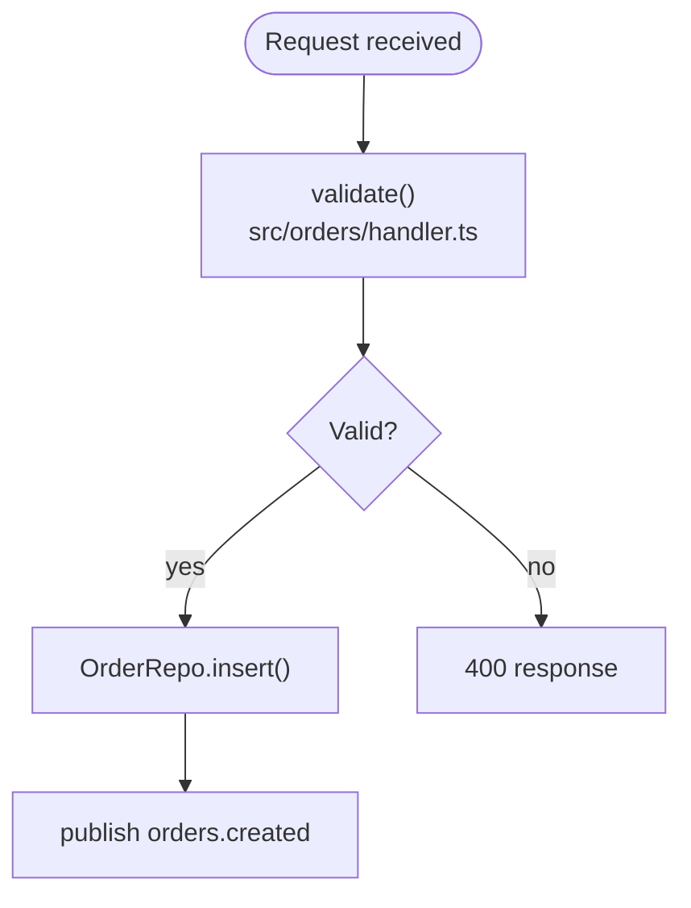
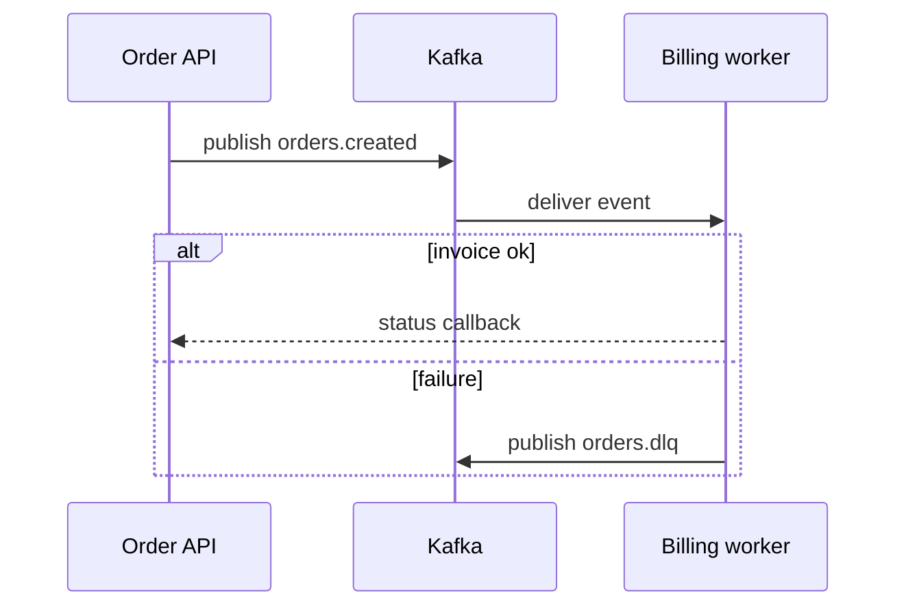
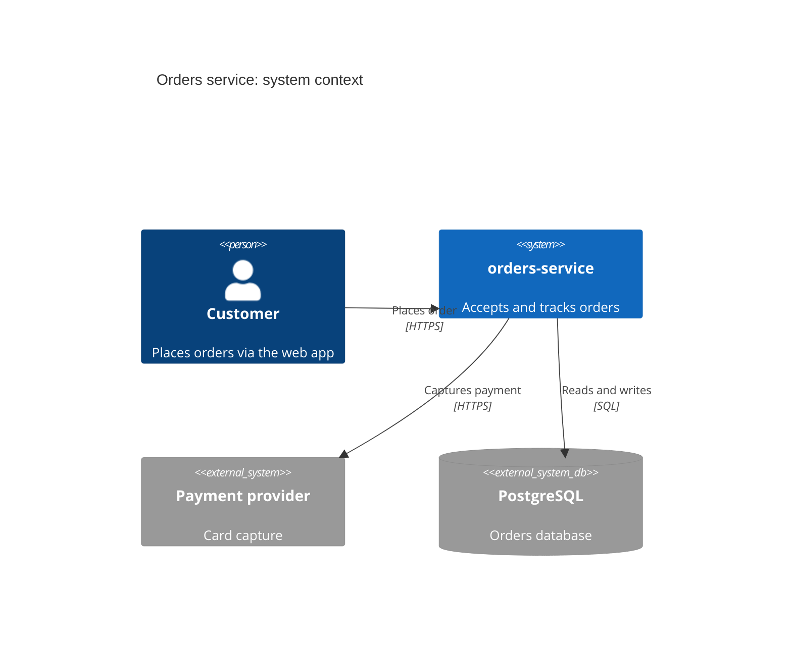
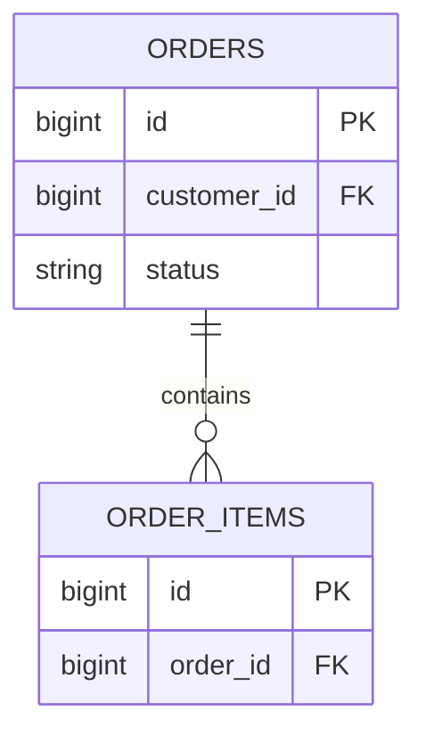

<!-- Portions adapted from Terrain (https://github.com/sopaco/terrain), MIT License, Copyright (c) 2026 Sopaco. See THIRD_PARTY_NOTICES.md. -->
# Mermaid rules

Every diagram must render. `ando check` parses every mermaid block and fails the run on a
parse error, so follow these rules strictly and prefer the simple form when unsure.

## Which diagram where

| Doc | Diagram | Type |
|---|---|---|
| `1.Overview.md` | system context: users, the system, external systems | `C4Context` |
| `2.Architecture.md` | context (may reuse the Overview one) | `C4Context` |
| `2.Architecture.md` | containers and main modules | `C4Container` |
| `2.Architecture.md` | components inside each core module | `graph LR` |
| `2.Architecture.md` | key flows | `sequenceDiagram` |
| `3.Workflows.md` | end-to-end path | `flowchart LR` with subgraphs |
| `3.Workflows.md` | each workflow with branches | `flowchart TD` |
| `3.Workflows.md` | each workflow's interactions | `sequenceDiagram` |
| `4.Deep-Exploration/README.md` | module dependencies | `graph TD` |
| `4.Deep-Exploration/<module>.md` | internal data flow (importance >= 4) | `flowchart TD` |
| `6.Database-Overview.md` | tables and relations | `erDiagram` |
| any | lifecycle with clear states | `stateDiagram-v2` |

Modules with importance <= 3 get no diagram.

## Node ids

- Letters, digits and underscores only: `A`, `B1`, `orderSvc`, `billing_db`.
- No spaces, hyphens, dots, `@`, slashes: not `order-svc`, `node.1`, `@user`.
- Convert names with camelCase: `orders-service` becomes `ordersService`.
- Do not use reserved words as ids: `end`, `graph`, `subgraph`, `class`, `style`,
  `click`, `default`.

## Labels

- Put every label in double quotes: `A["Order API"]`. Required whenever it has spaces,
  parentheses, colons, slashes, `@`, `#`, `&`, `<`, `>`, `{`, `}`, or non-ASCII
  characters.
- Line breaks inside a label: ` `, never a raw newline or `\n`.
- No double quotes inside a label. Use single quotes or rephrase.
- Name real things: `"OrderService create()"`, `"Kafka topic orders.created"`,
  not `"Service layer"`.
- Keep labels short: two lines, about 40 characters each.

## flowchart / graph

- Arrows: `-->`, `-.->`, `==>`. Never `->`.
- Edge labels: `A -->|"label"| B`.
- Decisions use braces and end with a question mark: `ok{"Valid?"}`.
- Subgraphs need an id plus a quoted title: `subgraph ingest["Ingest layer"]` ... `end`.
  Never `subgraph Ingest layer`.
- Link subgraphs by their id: `ingest --> process`.

## sequenceDiagram

- Declare every participant first: `participant id as Display name`.
- Messages: `A->>B: text` (call), `A-->>B: text` (return).
- Every `loop`, `alt`, `opt`, `par`, `critical` block closes with `end`.
- No semicolons in message text (they end the statement). Avoid `#` too.

## C4

- Keywords: `C4Context`, `C4Container`, `C4Component`.
- Elements: `Person`, `System`, `System_Ext`, `SystemDb_Ext`, `Container`,
  `ContainerDb`, `Component`; boundaries `System_Boundary(id, "Name") { ... }`,
  `Container_Boundary(...)`.
- Every argument after the id is a quoted string. Relations: `Rel(from, to, "label",
  "tech")`.
- Keep C4 diagrams under 15 elements: merge similar containers, group externals.

## erDiagram

- Entity names: letters, digits, underscores. Uppercase reads best.
- Attribute lines: `type name [PK|FK|UK] ["comment"]`. Types are single words: use
  `string` or `decimal` rather than `varchar(255)` or `numeric(10,2)`.
- Relations: `||--||` one to one, `||--o{` one to zero or many, `||--|{` one to one or
  many, `}|--|{` many to many. Always end with `: "label"`.
- Show core tables only (about 15); list the rest in the tables section.

## Size limits

- Flowcharts and graphs: at most about 25 nodes. Split by subsystem beyond that.
- Sequence diagrams: at most about 8 participants and 25 messages.
- C4: under 15 elements. erDiagram: about 15 entities.
- One idea per diagram. A diagram that needs a legend is too big.

## Common fixes

| Problem | Fix |
|---|---|
| Id with a hyphen or space | camelCase it: `order-api` to `orderApi` |
| Unquoted label with parentheses or a colon | quote it: `A["Retry (3x): backoff"]` |
| Subgraph title with spaces | `subgraph idName["Title with spaces"]` |
| `->` in a flowchart | use `-->` |
| Raw newline in a label | use ` ` |
| Unclosed `alt` or `loop` | add `end` |
| Too many nodes | split into one diagram per subsystem |
| SQL type with parentheses in erDiagram | use a single-word type |
